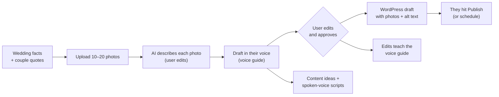

# Gathered Stories: Build Plan

Nov 3, 2026 · Ryan

This file has three parts:

- **Part 1: Where things stand.** What the app does today, and what Llena Vida's real website tells us.
- **Part 2: The plan.** What we're building, in what order, and what we're deliberately not building.
- **Part 3: Build guide.** Small chunks, each with a prompt to paste into Copilot.

---

# Part 1: Where things stand

## What the app does today

Gathered Stories is a four-step workspace: **Wedding → Photos → Draft → ShowIt pack.**

| Works today | How |
| --- | --- |
| Sign in | Passwordless email link (`components/AuthPanel.tsx`). No password flow needed. |
| Save and resume weddings | `app/api/weddings/`, row-level security per user |
| Write a draft | `lib/claude.ts`: title, slug, meta description, body, alt text, file names, photo captions, Reel script, caption, hashtags, Pinterest and email blurbs. Output is validated; the AI may not invent facts. |
| Edit and approve | `components/DraftReview.tsx`; approving only changes the status |
| Vendor credits | Saved vendor library, credits built by code (never by the AI), share kit for vendors (`lib/credits.ts`) |
| Send to WordPress | `lib/wordpress.ts`: encrypted application password, always creates a **draft** post, never publishes |

## What's missing compared to the goal

| Goal | Today | Gap |
| --- | --- | --- |
| User adds ~10 photos | Types a description of each photo | Biggest chore she complained about. The AI never sees an image. |
| Writes the way they write | Two buttons ("delicate" / "active") plus sentence-length stats from earlier **AI** drafts | Not their voice. It learns from its own output. |
| Post lands on their website | Text-only WordPress draft | No photos, no alt text in WordPress, no scheduling |
| Content ideas with scripts | One Reel script per wedding | No idea bank; scripts aren't in their *spoken* voice |

## What llenavidamedia.com tells us

Checked Nov 3, 2026.

**The platform:** the blog runs on **WordPress 6.9** (generator tag; uploads under `wp-content/uploads/sites/54710/`, a multisite path that fits Showit's hosted blog). Our existing WordPress delivery is the right road. **Unconfirmed:** whether Showit's hosting allows Application Passwords. Showit restricts some plugins ([Showit help](https://learn.showit.com/en/articles/424879-will-all-plugins-work-with-the-showit-wordpress-hosting)), but Application Passwords are built into WordPress core. The only way to know is to try (Phase 0).

**The voice is not what the prompt says.** It's a **husband-and-wife team** (Sean & Trinity Mirabella, Palm Springs and Southern California) who write as **"we"** to **"you."** The brand is offbeat on purpose: "the loud ones, the weird ones," goth and rock-and-roll weddings, color over beige. Their tone is playful, punchy and a little irreverent ("Crazy, we know."), with pop-culture jokes. The current prompt asks for "her voice: warm, editorial, not salesy" and offers "delicate and romantic." That's wrong on pronoun and tone.

**Their real-wedding posts quote the couple.** Their Escondido goth wedding post is built around the couple's own words. Our prompt (correctly) forbids invented quotes, but the app has no place to enter *real* ones.

**Their existing posts have SEO holes the app can fix:**

- About 14 photos in the Escondido post, all with empty alt text and "screenshot"-style file names
- Venue name in the body but not the title (title says "private estate")
- No subheadings in that post
- Mostly tips posts; few real-wedding or venue posts

That last point is the strongest argument for this app: they already have the weddings, they just aren't turning them into posts.

---

# Part 2: The plan

## The promise

> Add your favorite photos and a few notes from a wedding. Get back a blog post and content ideas that sound like *you*, ready to land on your website as a draft.

**Who it's for (for now):** one business, Llena Vida Media. No teams, no billing, no other photographers until they've used it on real weddings and asked for more.

## The flow



## Build order

| Phase | What | Why this order |
| --- | --- | --- |
| 0 | Collect material, test WordPress access (no code) | Everything below depends on it |
| 1 | Voice guide: built from their real writing, used in every prompt | Cheapest change with the biggest effect on quality |
| 2 | Real photo uploads; AI looks at them | Removes the typing chore |
| 3 | WordPress delivery with photos, alt text, scheduling | Makes the output usable without copy-paste |
| 4 | Learn from edits | Voice keeps getting closer over time |
| 5 | Content idea bank + scripts in their speaking voice | New feature; needs Phase 1's speaking samples |

Each phase ends with a real test on one of their weddings, not just passing checks.

## Decisions (and pushback)

- **Photos come from the user's own upload, not Pic-Time.** Pic-Time has no official public API (the only spec is [third-party](https://jentic.com/apis/pic-time.com/pic-time.md)). Revisit only if Pic-Time grants API access.
- **"Approve" still creates a WordPress draft by default.** Showit lays the post out in its own design. They should see a few posts in place before the app is allowed to go live on its own. Scheduling (a future publish date) is the middle ground and comes in Phase 3. A "publish immediately" setting can follow once they trust it.
- **Writing voice and speaking voice are separate.** Blog posts learn from their posts and site copy. Scripts learn from transcripts of them talking (TikTok/Reels captions, voice memos). A script written in blog voice sounds stiff read aloud.
- **Couple quotes are typed by the user and used word for word.** The AI may never invent or "polish" a quote.
- **Private venues.** Today the draft is rejected unless the venue name is in the title. That breaks "private estate" weddings. Add a "private venue" switch that uses the venue type plus city instead.
- **Photos sent to the AI.** Uploading real images means couples' photos go to Anthropic's API. That's normal for tools like this, but Sean & Trinity should know, and their client contract should already allow using photos for marketing. Photos stay in a **private** storage bucket.
- **Content ideas start with AI brainstorming, not Google scraping.** "People also ask" has no official API; automating it means a paid search-data service. Start with ideas built from their weddings, FAQ and wedding-season calendar. Add search data only if the brainstorm runs dry.

## Not building yet

| Feature | When it's worth adding |
| --- | --- |
| Pic-Time import | Pic-Time grants API access |
| HoneyBook import | HoneyBook ships an API (none as of 2026), or paste stops being enough |
| Publish immediately | They've approved ~5 posts without needing to fix layout in WordPress |
| "Fix my old posts" (alt text + titles for existing WordPress posts) | Good quick win after Phase 3; reuses the same pieces |
| Search data for ideas | The brainstorm runs dry |
| Other photographers, billing, teams | Llena Vida uses it on real weddings for a month and other pros ask |

## Phase 0 checklist (no code)

Ask Sean & Trinity:

- [ ] **WordPress test:** in their blog's WordPress admin, open **Users → Profile** and look for **Application Passwords**. If it's there, create one named "Gathered Stories." If it's missing, Showit's hosting may block it, and Phase 3 needs a different plan (copy-paste pack stays).
- [ ] **Writing samples:** 5–10 pieces they wrote themselves (blog posts they're proud of, Instagram captions, About page). Their blog is public, so the app can also read posts directly in Phase 1.
- [ ] **Speaking samples:** 2–3 videos of them talking to camera (TikToks/Reels are fine). Transcripts are enough.
- [ ] **Who writes:** both of them, or mostly one? Should posts say "we" always?
- [ ] **One real wedding** to test with: 10–20 favorite photos, the venue, and a couple of quotes from the couple (with permission).

---

# Part 3: Build guide

## How to use these prompts

1. Start a new Copilot chat per chunk. Use **Plan/Ask mode first** if your Copilot has it, so it can't edit files while planning.
2. Paste the prompt. When Copilot shows its plan, read it. If you can't tell whether it's right, paste it into Claude before approving.
3. After it builds: run `npm run typecheck` and `npm test`, then **click through it yourself.**
4. Write a short entry in `docs/re-entry.md`: what was built, what you understand, what's still fuzzy, next step.

Every prompt starts with this shared preamble. Paste it once at the top of each chat:

```
Context: Gathered Stories is a Next.js + TypeScript + Supabase app (see README.md and CODE_TOUR.md).
It writes wedding blog posts and social content for Llena Vida Media, a husband-and-wife
photo/video team in Palm Springs. Rules for every change:
- Inspect the relevant files before proposing changes. Don't invent tables, routes or functions.
- Keep secrets server-only. Never use a NEXT_PUBLIC_ prefix for keys.
- Every user-owned table gets row-level security using auth.uid(), with USING and WITH CHECK.
- New database changes go in a new file in supabase/migrations/ and are mirrored in supabase/schema.sql.
- Add a SQL test in supabase/tests/ for any new table or policy (see vendors_rls_test.sql).
- Validate all inputs with Zod on the server. Never trust IDs or paths sent by the browser.
- Don't add dependencies unless the prompt says so, or you ask first.
- Update README.md and CODE_TOUR.md when behavior changes.
- Show me your plan and STOP. Wait for my approval before writing code.
```

---

## Phase 1: Voice guide

### Chunk 1.1: Voice guide storage and settings screen

```
Add a "voice guide" the business owns and can edit.

1. Migration: a voice_guides table, one row per user (user_id primary key), with:
   writing_guide text (max 4000 chars), speaking_guide text (max 4000 chars),
   writing_samples jsonb array (max 10 items, each max 6000 chars),
   speaking_samples jsonb array (max 10 items, each max 6000 chars), updated_at.
   RLS: a user reads and writes only their own row.
2. API route app/api/voice-guide/route.ts: GET returns the signed-in user's row (or empty
   defaults); PUT validates with Zod and saves.
3. A "Voice" screen reachable from the header: two tabs, "Writing" and "Speaking". Each tab has
   a list of samples (paste text, add/remove) and the guide itself in an editable textarea.
   Autosave like the wedding form does.
4. Test: supabase/tests/voice_guides_rls_test.sql proves user A can't read or write user B's row.

Don't change lib/claude.ts yet.
```

### Chunk 1.2: Build the guide from samples (and their public blog)

```
Let the user generate a first draft of their voice guide from their samples.

1. Server route app/api/voice-guide/analyze/route.ts (auth required). Input: which guide
   ("writing" or "speaking"). It reads that user's samples from voice_guides, sends them to
   Claude, and returns a proposed guide. It does NOT save; the user reviews and saves.
2. The proposed guide is plain text with these sections: Who's speaking (pronouns, e.g. "we"
   to "you"), Tone, Sentence rhythm, Words and phrases they use, Words they'd never use,
   Humor, How they open, How they close, 3 short example passages in their style (written
   fresh, not copied from samples).
3. Optional import: if the user has a WordPress connection, an "Import my recent posts"
   button fetches their 10 most recent published posts from /wp-json/wp/v2/posts (public,
   no auth needed), strips HTML to text, and adds them as writing samples. Reuse the
   validated, pinned request helper in lib/wordpress.ts; do not add a new HTTP client.
4. Show the proposal next to the current guide with "Use this" and "Keep mine" buttons.
```

### Chunk 1.3: Use the guide in drafts; fix the prompt

```
Make drafts use the voice guide instead of the fixed tone.

1. In lib/claude.ts, replace the hard-coded "Write in her voice: warm, editorial, not salesy"
   system text. The system prompt should say the writer is a wedding photo/video business,
   then include the user's writing_guide verbatim as the voice to follow. If no guide exists,
   use a neutral default and show a banner in Step 3 linking to the Voice screen.
2. Replace the "delicate" / "active" voice option with an optional per-wedding "mood" text
   field (max 120 chars, e.g. "moody goth glam", "bright desert pool party"). Keep a database
   default so existing rows still work. Write the migration so it's safe on existing data.
3. Add a "Couple quotes" field to the wedding form: up to 6 quotes, each max 300 chars,
   with who said it ("bride", "groom", "partner", or a first name). Send them to Claude with
   the rule: use quotes word for word or not at all; never invent, edit or merge quotes.
   Add a server-side check: any text inside quotation marks (straight or curly) in the draft
   body must appear word for word in one of the supplied quotes; reject the draft otherwise.
   With no quotes supplied, the body may contain no quotations at all.
4. Private venues: add a "private venue" checkbox and a venue_type field (e.g. "private
   estate"). When checked, the title/body check uses venue_type + city instead of the venue
   name, and the venue name is never sent to Claude.
5. Remove the approvedWorkStyleProfile function in app/api/generate-post/route.ts; the guide
   replaces it. Keep the similarity warning.
6. Update the unit tests and add tests for the quote check and private-venue check.
```

**Test it:** write a draft for one real Llena Vida wedding. Read it aloud. Does it sound like "we" talking to "you," with their humor? If not, edit the guide, not the code.

---

## Phase 2: Real photos

### Chunk 2.1: Private photo uploads

```
Let users upload 10–20 photos per wedding instead of typing descriptions.

1. Migration: a private storage bucket "wedding-photos" (JPEG/PNG/WebP, max 5 MB each). Storage
   policies on storage.objects: a user can insert, read, update and delete only objects whose
   path starts with their own auth.uid()/. Path format: {user_id}/{wedding_id}/{random-uuid}.jpg.
   Insert must also check that wedding_id belongs to that user.
2. Table wedding_photos: id, wedding_id, user_id, storage_path, sort_order, description,
   is_cover boolean, created_at. RLS by user_id; a photo's wedding must belong to the same user.
3. In the browser, shrink each image to max 1600px on the long side as JPEG (~0.85 quality)
   before upload, using a canvas. No new dependencies.
4. Replace the text-only PhotoPicker with a grid: drag-and-drop or choose files, thumbnails
   (via short-lived signed URLs, 10 minutes), reorder, remove, pick a cover photo, and a
   description box under each photo.
5. Server-side, check the file's first bytes really are JPEG/PNG/WebP; don't trust the
   extension or the browser's MIME type.
6. Keep existing weddings with typed descriptions working.
7. Tests: storage policy test with two users (A can't read, overwrite or delete B's files),
   and the byte check.
```

### Chunk 2.2: AI describes the photos

```
Add a "Describe photos" button on the Photos step.

1. Server route app/api/weddings/[id]/describe-photos/route.ts (auth; verify the wedding
   belongs to the user). It downloads that wedding's photos from storage server-side,
   sends them to Claude as images in batches of up to 10, and returns one description per
   photo: what's visible, mood, setting details useful for SEO. No guesses about names,
   relationships or brands.
2. Fill the description boxes; the user can edit any of them. Don't overwrite a description
   the user already typed unless they confirm.
3. Draft generation keeps using the (edited) descriptions; it does not resend images.
4. Return a clear error if any photo is missing or unreadable. Log no image content.
5. Update the README privacy section: photos are now uploaded and sent to Anthropic's API
   for description.
```

**Test it:** upload a real gallery's favorites. Time how long Step 2 takes versus typing.

---

## Phase 3: WordPress with photos

### Chunk 3.1: Upload photos to WordPress with alt text

```
When sending an approved draft to WordPress, include the photos.

1. For each wedding photo in order: upload it to /wp-json/wp/v2/media using the draft's
   photoFileNames[i] as the filename, then set alt_text, caption and title from the draft
   (POST /wp-json/wp/v2/media/{id}). The existing wordpressRequest helper in lib/wordpress.ts
   only sends JSON. Extend it (don't replace it) to also send a raw image body with
   Content-Type and a Content-Disposition filename header, keeping its IP pinning,
   no-redirect and response-size limits.
2. Set the cover photo as the post's featured_media.
3. Build the post content as WordPress block HTML (paragraphs, headings, image blocks) from
   the draft body, placing photos between sections in order. Convert the markdown headings
   (#, ##, ###) to h2/h3. Escape all text.
4. Make delivery safe to retry: record each uploaded media ID so a retry doesn't upload
   duplicates. Keep the existing delivery lock.
5. Still create the post with status "draft".
6. Tests for the markdown-to-blocks converter and the retry behavior.
```

### Chunk 3.2: Schedule instead of draft

```
On the ShowIt step, add a choice: "Save as WordPress draft" (default) or "Schedule for" with a
date and time (America/Los_Angeles). Scheduling creates the post with status "future" and the
matching date. Show the scheduled time in the wedding list. Never offer "publish now" yet.
```

**Test it:** send one real post, then open it in Showit's blog preview. Do photos, headings and credits sit right in their design? Fix layout before going further.

---

## Phase 4: Learn from edits

### Chunk 4.1: Keep the AI original

```
When a draft is generated, save the AI's original content alongside the editable content
(drafts.original_content jsonb). Edits never change original_content. Migration must be safe
for existing drafts (copy current content into original_content).
```

### Chunk 4.2: Suggest voice guide updates

```
After a draft is approved, offer "Learn from my edits."

1. Server route compares original_content.body with the approved body and asks Claude:
   what did the user consistently change (words removed, phrases added, tone shifts)?
2. Claude proposes specific additions or edits to the writing_guide (not a rewrite).
3. Show the proposal; the user accepts, edits or ignores it. Nothing changes without a click.
4. Skip when the edits are tiny (under ~5% of words changed).
```

---

## Phase 5: Content ideas and scripts

### Chunk 5.1: Idea bank

```
Add an "Ideas" section, separate from weddings.

1. Table content_ideas: id, user_id, title, angle (text), format ("reel", "tiktok", "carousel",
   "blog"), source ("wedding", "faq", "season", "manual"), wedding_id (nullable, must belong to
   the user), status ("idea", "scripted", "filmed", "posted"), script jsonb, created_at.
   RLS by user_id.
2. "Brainstorm" button: Claude proposes 10 ideas using the user's approved weddings (venue,
   mood, favorite moments), their service list and FAQ topics (a user-editable list on the
   Ideas screen), and the month (e.g. engagement season in December–February, wedding
   season prep in spring). Each idea: title, one-line angle, format, why couples would care.
3. Ideas show as a simple board by status. User can add, edit, delete and drag between columns.
```

### Chunk 5.2: Scripts in their speaking voice

```
On an idea, add "Write script."

1. Uses the speaking_guide (not the writing_guide). If it's empty, show a link to the Voice
   screen and don't generate.
2. Script shape: hook (first 2 seconds, on-screen text + spoken line), 3–6 beats (spoken
   line, what's on screen, suggested clip type from their footage), payoff, call to action,
   estimated length in seconds. Spoken lines should be short and sound natural out loud.
3. "Read-aloud check": show the spoken lines alone, one per line, so the user can read
   them out loud and edit.
4. Status moves to "scripted" when saved.
```

**Test it:** have Trinity or Sean read one script on camera without editing. If they stumble or it sounds unlike them, improve the speaking guide.

---

## Re-entry notes

Add entries to `docs/re-entry.md` after each chunk:

```
## YYYY-MM-DD: Chunk X.Y
- Built:
- Applied to Supabase: yes / no (which migration)
- Tested with: (real wedding? test data?)
- Understand well enough to explain:
- Still fuzzy:
- Next step:
```
